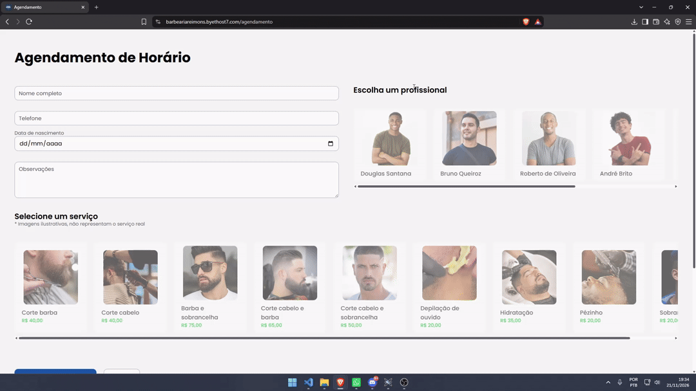

# Sistema de gerenciamento de agendamentos

### Objetivo
Desenvolver uma aplicação web para fortalecer a presença digital da Barbearia Reimons, facilitar o agendamento de serviços e auxiliar no gerenciamento dos clientes e horários. 

### Integrantes
* Guilherme Schiavolin Santos
* Matheus Capretz Camargo
* Pedro Rafael Pimenta Martins
* Vitor Faggiani D’Agostini 

### Tecnologias utilizadas
Para o desenvolvimento das páginas como um todo, foi utilizado ```html``` juntamente de ```css``` para a estilização e ```javascript``` para as funcionalidades, como validação de formulários, alertas na tela, etc.
Para o dinamismo da página, utilizamos a linguagem de _backend_ ```php```, uma linguagem robusta, juntamente com ```sql``` para a criação das _querys_ (consultas) ao banco de dados

---

### Como acessar
Você pode acessar o sistema web através do seguinte link: <a href="https://barbeariareimons.byethost7.com/" target="_blank">Clique aqui!</a>

---

### Principais funcionalidades
* Agendamento de horários, respeitando dias da semana (fechado aos domingos) e seus respectivos horários (segunda à sexta, 9:00 às 20:00 e sabados, 9:00 às 18:00);
* Download de comprovante de agendamento;
* Gerenciamento de agendamentos (com possibilidade de remarcar horários e cancelar agendamento)
* Gerenciamento de barbeiros (edição da conta, nível - administrador ou barbeiro - e criação de novas contas);
* Gerenciamento de serviços (edição de serviços atuais, desativação/ativação e criação de novos serviços);
* Responsividade.

---

### Funções

Agendamento



---

Adicionando novo serviço

